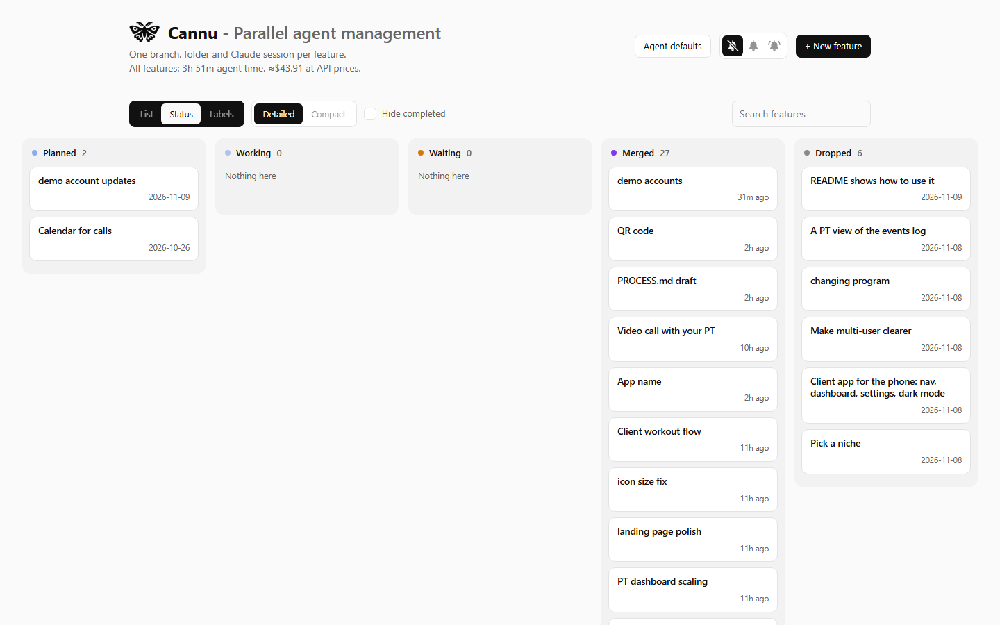
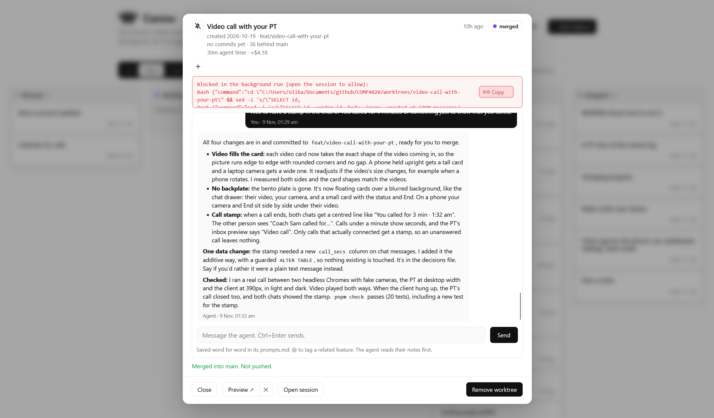

# Cannu: parallel agent management

Cannu runs Claude Code agents in parallel, one per feature, on any git repo,
and shows them all on one board. Node built-ins only, nothing to install. It
started as the tool I used to build Spotter for COMP4020, and moved here once
that was done.



**What it does**

- Each feature gets its own git branch, worktree, app port, data folder and
  Claude Code session, so agents never trip over each other.
- One board shows every feature by status (planned, working, waiting, merged,
  dropped), what each agent is doing, and what it's cost in time and money.
- Chat with an agent from its card, or open the real session in a terminal.
- Preview each feature's own copy of the app.
- Ship a feature either way, from its card. **Check and merge** runs the
  repo's check against the branch and merges it locally. **Open PR** pushes
  it, opens a pull request and shows the CI result on the card.
- Every message I send is written word for word into the feature's
  `prompts.md` by a hook, next to the agent's `log.md` and `decisions.md`.
- Notifications when an agent needs me, finishes, fails or gets stuck.
- A small HTTP API, so another agent (Hermes) can drive it. See `hermes/`.



**Why it's called Cannu.** It's named after Can Nü (蠶女), the silkworm girl of
Chinese myth and the goddess of silkworms and silk. Each agent is a silkworm
spinning its own thread in parallel, and Cannu weaves the threads into
something bigger.

## Running it

You need Node 24 or later, git, and Claude Code logged in. You also need `gh`
logged in if you want pull requests.

```
cp config.example.json config.json   # list your repos in it
node server.js                       # then open http://localhost:4000
```

You install Cannu once. One Cannu runs every repo listed in `config.json`, on
one port. The dropdown right of **+ New feature** switches between them. Its
**+ Add repo** offers git repos found next to the ones you have, or takes any
folder, and starts that repo's board straight away without a restart. It's
saved in `config.json`. Picking a repo there also fills in how to work on it:
its own `cannu.json`, or Cannu's guess from its lockfile, `package.json` and
`mise.toml`. Saving writes `cannu.json` into the repo (only what isn't a
default) and commits it on its main branch. The bin next to a repo takes it
off the board. Nothing on disk is deleted, so adding it back picks up where it
left off.
Each repo's board has its own address (`http://localhost:4000/#macros`), so
you can keep one tab per repo.

Behind the board, `server.js` runs a `repo.js` for each repo on its own
internal port. If one crashes, only that repo's board goes down, and it
restarts on its own. Its log is `local/<repo>.log`.

On Windows, `start-hidden.vbs` runs it with no window (output goes to
`local/dashboard.log`). Put a shortcut to it in `shell:startup` to start it
at login. Restart after changing `config.json` or any `.js` file.
`index.html` and `cannu.json` are read on every use.

### In Docker, on a server

`compose.yml` runs Cannu on a Linux server, using the host's Claude Code and
`gh` logins. Read the comment at the top of it first. Two rules matter:

- Mounts use the same paths inside and outside the container. Git worktrees
  record absolute paths, and Claude Code names each transcript folder after
  the working directory. A session opened from an SSH terminal on the host
  and one started in the container are only the same session if the paths
  match.
- Give Cannu its own clone of each repo, all under one folder
  (`CANNU_REPOS` in `compose.yml`). Agents commit to it and Cannu merges into
  its main, so it shouldn't be a folder a live container builds from.

Cannu has no login and can start agents that run commands, so it listens on
`127.0.0.1` only. To reach it from other machines, set `"host"` in
`config.json` to a list such as `["127.0.0.1", "100.94.103.45"]` (a Tailscale
address), or put a reverse proxy in front. Never use `0.0.0.0` on a network
you don't control.

## The two config files

**`config.json`** lives next to Cannu and is gitignored. It describes this
machine and lists the repos.

| Key | Default | What |
| --- | --- | --- |
| `repos` | | The repos, each `{ "repo": "../macros" }`. Paths are relative to this file. A repo can also set `name` (its picker label and address, default the folder's name), `worktrees` (default `<repo>-worktrees`) and `firstFeaturePort` |
| `port` | `4000` | The board. Each repo's own Cannu takes the next ports up (4001, 4002, ...), on localhost only |
| `firstFeaturePort` | `8100` | Feature apps get ports from here, in a block of 100 per repo, so repos never clash |
| `host` | `127.0.0.1` | Where the board listens. A string or a list |
| `claudeSettings` | | A settings file passed to Claude with `--settings`, such as one holding an API key, so Cannu never reads the key |
| `launchPrefix` | | Put before the Open session command, such as `ssh atlas ` |

**`cannu.json`** lives in the repo's root and is committed there. It says how
to work on this repo. Every key is optional, and `cannu.example.json` has an
example of each.

| Key | Default | What |
| --- | --- | --- |
| `main` | `main` | The branch features start from and merge into |
| `notes` | `notes/features` | Where each feature's notes folder goes |
| `commitNotes` | `true` | `false` keeps feature notes out of git entirely. They all live in the main folder, kept out of git through `.git/info/exclude`, so nothing is ever committed or pushed and a fresh clone has none. Agents are told not to `git add` them |
| `copy` | `[]` | Files and folders git doesn't have (a local database, `.env`), copied from the main folder into each worktree. `.db` and `.sqlite` files are copied safely while open |
| `setup` | `[]` | Commands run once in a new worktree, such as installing packages |
| `app` | | The command that runs the app. It gets `PORT`, `DATA_DIR` and `APP_URL`, and must listen on `PORT`. With no app, Preview is greyed out and says why. Cannu's own is `scripts/preview.js`, which runs the feature's copy of Cannu on a demo repo, never your real ones |
| `seed` | `[]` | Commands run once the app is up, such as loading demo data. They should skip what's already there |
| `check` | `package.json`'s `check` or `test` script | What Check and merge runs, with `APP_URL` pointing at a fresh copy of the branch's app |
| `merge` | `local` | Which ship button is the main one: `local` or `pr`. Both are always there |
| `agent` | | Agent defaults, written by the Agent defaults popup |

Every command runs in the feature's folder through the shell, with the
feature's `PORT`, `DATA_DIR`, `APP_URL` and `FEATURE_SLUG` set.

## What every agent is told

Each agent reads the repo's own `CLAUDE.md`, and Cannu also gives it a short
system prompt. It says which feature and branch the agent is on, to commit as
it goes and never push or switch branches, to keep `log.md` and
`decisions.md` in its notes folder, how to restart its app, and which check to
run. The repo doesn't need to say any of that.

## Where features are recorded

Each feature is a folder on main, `<notes>/<slug>/`:

- `feature.md`: title, status, dates and what I asked for. Only the dashboard
  writes it, and every change is a commit on main ("Start feature: X",
  "Merged: X", "Dropped: X").
- `prompts.md`: every message I sent the agent, word for word, written by a
  hook. Anything the dashboard added comes after a line saying
  `[Added by the dashboard, not my words]`.
- `log.md` and `decisions.md`: what the agent did and why, and every decision.

In `feature.md` a feature is **planned** (no branch yet), **building**
(branch, folder and agent), **merged** (in main, and that's finished) or
**dropped** (kept on record, not doing it). On the page, building splits into
**waiting** (its agent has stopped and it's my turn) and **working**.

## Board and list

There are three views, picked with the switcher left of the search box:

- **By status**: a column per status (Waiting, Working, Planned, Merged,
  Dropped). Cards move on their own as agents change.
- **By label**: a column per label, plus Unlabelled. Drag a card to another
  column to relabel it.
- **List**: cards in a list with a filter per status.

On the board, **Detailed** cards show the label (or the status, in the label
view), what a working agent is doing and the start of a waiting agent's last
reply. **Compact** is one line per feature. **Hide completed** hides merged
and dropped features. All three are remembered per browser.

Clicking a board card opens it in a popup with the cursor in the message box,
so a card moving underneath never moves what you're doing. The popup has the
card's details, its labels, the chat and the card's buttons.

**Labels**: one per feature, any text. Click one in the popup to set it (click
it again to clear it), or click **+**, type a new one and press Enter. It's
saved as `- Label:` in `feature.md` and committed on main. A label's colour
comes from its name.

## What each button does

- **+ New feature** (a popup): a name, what I want, and a model (the agent
  default unless I pick one, recorded in `feature.md`). What I've typed is
  kept for the browser tab if I close the popup. **Start agent** commits its
  `feature.md` on main, makes a worktree on branch `feat/<slug>`, copies in
  what `cannu.json` lists under `copy`, runs its `setup`, starts the `app`,
  runs its `seed`, and starts the agent on my prompt in the background.
  **Save as planned** only commits the `feature.md`.
- **Start agent / Edit / Drop** (planned features): start it as above, change
  what it says, or mark it dropped.
- **Drop** (building features): for a bad idea. Its app stops and it's
  recorded as dropped. Its folder and branch stay until **Remove worktree**,
  which commits anything uncommitted to the branch first and keeps the branch,
  so the work and notes are still in git.
- **Chat**: the conversation so far, read from Claude Code's saved transcript,
  and a box to message the agent. A message goes as a background turn
  (`claude -p --resume`). If the agent is mid-turn, the message waits and goes
  as soon as the turn ends. If the session is open and idle in a terminal,
  sending closes that terminal session first, since one session can't run in
  two places. The conversation is kept, so Open session picks it back up.
  Anything a background turn wasn't allowed to do is listed in red.
- **Open session**: the same session in a terminal, for watching it live or
  approving something. On Windows it opens a Windows Terminal tab. On Linux,
  macOS or Docker it gives you the command to run and copies it. Closing the
  terminal ends that run of the session, not the session.
- **Preview ↗ | ✕**: Preview starts the feature's app if it isn't running and
  opens it. ✕ stops it. Agents restart it after changing code with
  `curl -s -X POST $CANNU_URL/api/features/$FEATURE_SLUG/apprestart`.
- **Check and merge**: commits the hook's `prompts.md` and refuses if the
  feature or main has uncommitted changes. Then it starts the branch's own app
  on port + 1000, runs the `check` against it, and runs
  `git merge --no-ff` into main. On a conflict it aborts and fills in a
  message asking the agent to merge main in. It never pushes.
- **Open PR / Push / Merge PR**: Open PR pushes the branch and opens a pull
  request with `gh`. The card then shows the PR's CI checks, review and
  conflicts, refreshed every 30 seconds. **Push** sends new commits to the PR.
  **Merge PR** merges it on GitHub, pulls main down, records the feature as
  merged and pushes that record. A PR merged directly on GitHub is picked up
  the same way.
- **Remove worktree**: deletes the folder and branch once merged. The feature
  stays in the list with its notes, read from main.
- **Carry on** (on an interrupted card): resumes the session with a message
  telling the agent it was cut off.
- **Retry setup**: re-runs setup. Each step skips what's already done.
  Unfinished setups also re-run when the dashboard starts.
- **Reopen** (merged or dropped features): a new feature that continues the
  old one. **Start agent** makes a new branch from current main and a new
  session pointed at the old notes. **Save as planned** records it to start
  later.
- **@ tagging**: typing @ in a description or a chat message lists matching
  features. Picking one writes `@slug`, which points the agent at that
  feature's notes (recorded as Related in `feature.md`).
- **Agent defaults** (a popup): everything the dashboard sends an agent. That
  covers the default model, the system prompt, extra environment variables,
  the carry on, new session and merge conflict messages, and what background
  turns may and may never do. Only what differs from the built-in values is
  saved, under `agent` in `cannu.json`, and committed on main.
- **Bells**: notifications when an agent needs me, finishes, fails or is
  interrupted, only while the page is open. The options are silent, only
  features with their bell on, or all.
- Every card ends with one row of buttons: everyday ones on the left, and on
  the right in black the one that moves the feature on. Drop, Check and merge,
  Open PR, Merge PR and Remove worktree ask "are you sure?" first.

## Waiting and working

A building feature is **working** while its agent is mid-turn or being set
up, and **waiting** otherwise. The pill adds why when it matters:

- **needs you**: it's asking for permission in its terminal.
- **terminal open**: it finished its turn, and its terminal session is open.
- **interrupted**: it was mid-turn when its process died. Use Carry on.
- **error**: the last background run failed. Its output is on the card.
- **never started**: the agent never got going.
- **stuck**: it's mid-turn, but nothing has happened for 3 minutes: no hook
  report and nothing written to its transcript. The card says what's still
  running under the agent, with **End that step** to kill just that so the
  agent carries on. For a background turn there's also **Stop the turn**.

Liveness comes from the claude process IDs that `launch.js` and background
runs record. They're checked with `tasklist` on Windows and `/proc` elsewhere.

## How it knows what agents are doing

Each worktree gets a `.claude/settings.local.json`, kept out of git through
the repo's `.git/info/exclude`. It holds the worktree's `PORT`, `DATA_DIR`,
`APP_URL`, `CANNU_URL`, git identity, and hooks that run this folder's
`hook.js`. It's rewritten whenever the dashboard starts. It also turns off the
GitKraken hooks plugin for agents (it held a permission request open for 20
minutes) and the Claude co-author line on their commits. The hook writes
`local/state/<slug>.json` and appends every message to the feature's
`prompts.md`. Time and cost per feature come from the transcripts Claude Code
saves under `~/.claude/projects/`, priced at API rates.

## Driving it from another agent

`GET /api/repos` lists the repos. For each one, `GET /r/<repo>/api/status`
returns a short list of every feature and what its agent is doing, and the
actions are plain `POST`s under `/r/<repo>/api/`. `hermes/SKILL.md` is a skill that
teaches Hermes, or any agent that reads skills, to start features, check on
them, message them and ship them. It asks first before anything that merges
or deletes. Copy it into the agent's skills folder.

## Speed

Every open page polls every 2 seconds. A feature's git state is only re-read
when its agent reports something, after an action, or every 15 seconds, and
then for every feature at once without blocking the server. Open pages share
one result, and a transcript is only re-read when it changes. Before this, a refresh with
8 worktrees on Windows took about 6 seconds, because each feature's git reads
ran one after another and blocked everything else, chat included.
